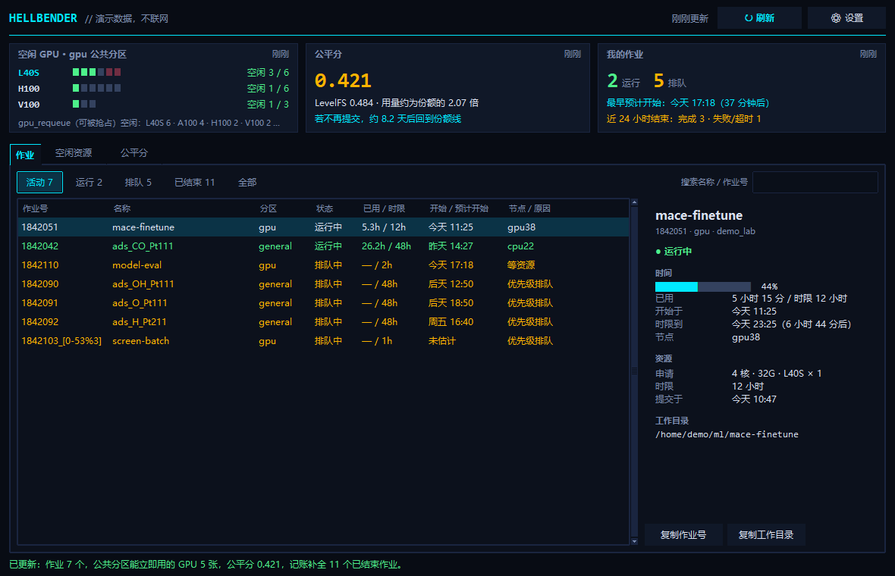
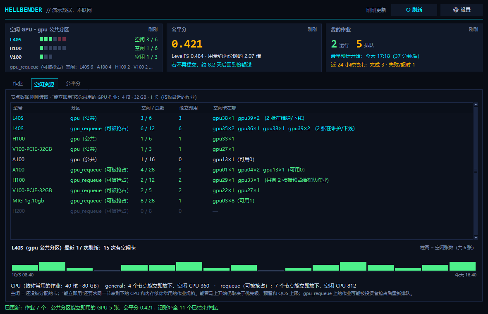
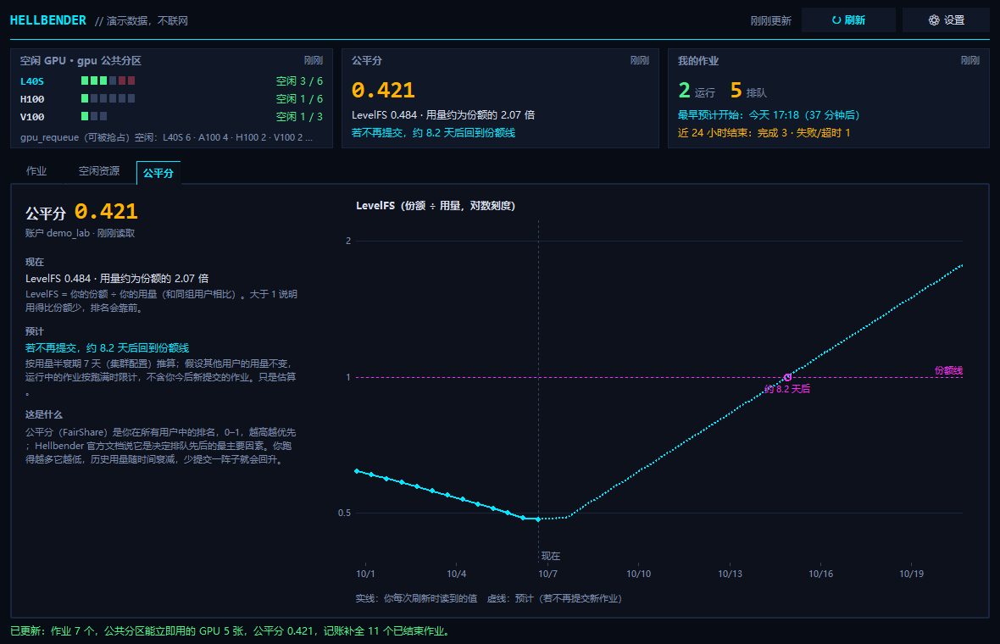

# Hellbender Viewer

A small, read-only desktop monitor (Python/Tk) for **your own** Slurm jobs on the University of Missouri **Hellbender** cluster. One click shows:

- your running and pending jobs, with **Slurm's expected start time** for pending ones;
- **GPUs that are free right now** and would actually fit your usual GPU job (per partition and GPU model);
- your **fairshare** and how it is likely to recover.

It never changes anything on the cluster and only talks to it when you press Refresh. Unofficial; not affiliated with MU Research Computing Support Services.

中文说明见 [README.zh-CN.md](README.zh-CN.md). The interface itself is in Simplified Chinese.



## What you get

- **Three cards** at the top: free GPUs in the public `gpu` partition (your watched model, e.g. L40S, first; a line for the preemptible `gpu_requeue`), fairshare with a projection, and a job summary (running / pending, earliest expected start, last 24 h outcomes).
- **Jobs tab**: active / running / pending / finished / all, search, and a detail panel with expected start (or your historical median wait in that partition), walltime used vs. limit, the median runtime of your similar finished jobs, resources and the working directory (copy buttons).
- **Idle resources tab**: free / total and "usable now" GPUs per partition × model and the nodes they are on, a history of how often your watched model was free when you refreshed, and CPU partitions that can fit your usual CPU job.
- **Fairshare tab**: current factor and LevelFS, your past readings and a projection with its assumptions spelled out.




## How it touches the cluster

Only when you click **Refresh** (or press F5). One short SSH session runs fixed, read-only commands, each with its own timeout:

| What | Command | How often at most |
| --- | --- | --- |
| your jobs | `squeue --user="$USER" …` | every refresh (≥ 5 min apart) |
| nodes and GPUs | `sinfo --Node -O NodeList,Partition,StateLong,CPUsState,Memory,AllocMem,Gres,GresUsed` | every refresh |
| your fairshare | `sshare --Users …` | every 30 min |
| priority settings | `scontrol show config \| grep '^Priority'` | every 7 days |
| your finished jobs | `sacct --user="$USER" --starttime=<since last sync> …` | every 15 min |

Nothing runs at startup, while hidden, or on a timer; no files are read on the cluster; no job or node is ever modified. Limits persist across restarts and failures back off. Because accounting is synced incrementally, jobs that start and finish between two refreshes are still recorded with their final state. Full details and sources: [COMMAND_POLICY.md](COMMAND_POLICY.md).

## Requirements

- Python 3.10+ with Tk. The app uses only the standard library.
- An OpenSSH client and an SSH alias that logs in **without prompts** (key loaded in ssh-agent). On Windows the app calls the built-in `C:\Windows\System32\OpenSSH\ssh.exe`, which can use the Windows ssh-agent service.
- Tested on Windows 11. The Linux and macOS GUI have not been tested.

Example `~/.ssh/config` entry (take the login host from the Hellbender documentation):

```text
Host hellbender
    HostName <Hellbender login host>
    User <your username>
    IdentityFile ~/.ssh/id_ed25519
```

## Run

```text
git clone https://github.com/iserlohn0522-cell/hellbender-viewer-public
cd hellbender-viewer-public
python hellbender_viewer_v2.pyw --demo   # offline demo with synthetic data
python hellbender_viewer_v2.pyw          # live; SSH alias "hellbender" by default (change in ⚙ 设置)
```

On Windows, `Launch.vbs` / `Demo.vbs` start it without a console window; point a desktop shortcut at `pythonw.exe "<folder>\hellbender_viewer_v2.pyw"`. Closing the window hides it to the tray icon; quit from the tray menu.

## Build your own

```text
python -m pip install -r requirements-dev.txt         # pytest + Pillow, for tests and screenshots only
python -m pytest tests -q                              # offline; one test runs the remote script under a local sh if available
python tests/ui_check.py screenshots Neon Midnight Daylight   # demo screenshots, no network
python build.py                                        # -> dist/HellbenderViewer-<version>.pyz
python dist/HellbenderViewer-3.0.0.pyz --demo
```

The `.pyz` is a portable zipapp; it still needs Python with Tk and OpenSSH on the machine that runs it.

Adapting it: the SSH alias, watched GPU models and your usual job size are in the settings dialog. The cluster time zone is `CLUSTER_TZ` in `hellbender/insights.py` (America/Chicago for Hellbender). GPU partitions are those whose name contains `gpu`.

## What the numbers mean

- **Free GPU**: configured but not allocated, on nodes that accept work. **Usable now** also needs enough idle CPUs and unallocated memory on the same node for your usual GPU job. Nodes held by the backfill scheduler for a waiting job and nodes that are down or drained are counted separately. None of this guarantees an immediate start (priority, reservations and QOS limits still apply), and `gpu_requeue` jobs can be preempted.
- **Fairshare**: Slurm's factor for your association. Under Fair Tree it is a rank among users (0–1, higher starts sooner) and is not projected. The projection is of LevelFS (your share ÷ your usage among siblings), using the cluster's `PriorityDecayHalfLife`, counting running jobs up to their time limits and holding other users' usage constant. It is an estimate.
- **Expected start**: Slurm's own backfill estimate, converted to your local time. It changes as the queue changes.

## Local data

Everything is stored locally in SQLite: `%LOCALAPPDATA%\HellbenderViewer\monitor.sqlite3` on Windows (`~/Library/Application Support/HellbenderViewer` on macOS, `$XDG_DATA_HOME/hellbender-viewer` on Linux). Demo mode uses a separate `demo.sqlite3`. Nothing is uploaded anywhere.

## License

MIT — see [LICENSE](LICENSE).
